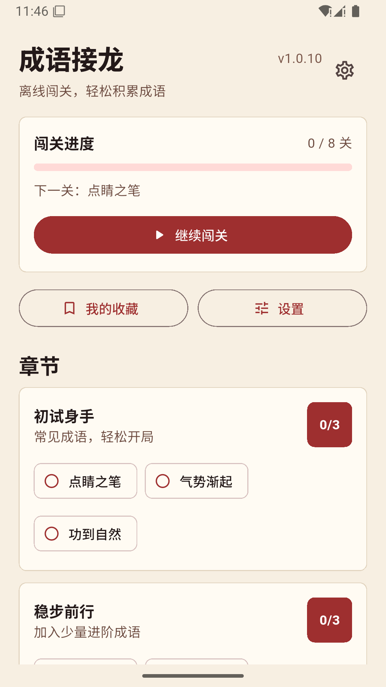

# 成语接龙 | Chinese Idiom Chain

一款离线成语接龙学习 App，内置约 3 万条四字成语，提供拼音、释义、例句、闯关和收藏。

An offline Chinese idiom chain game for Android with about 30,000 four-character idioms, pinyin, definitions, examples, levels, and favorites.

## 界面截图

## 主要功能

- 约 3 万条四字成语，含拼音、释义和例句
- 按首尾字接龙闯关，并即时说明答案是否匹配
- 提示功能帮助继续学习
- 收藏成语，便于复习
- 完全离线运行，无需注册或联网

## 下载与安装

[下载 Android APK（v1.0.10）](https://github.com/heyPython2026/chengyu-jielong/releases/latest/download/ChengyuJielong-v1.0.10-universal-release.apk) · [查看版本与校验值](https://github.com/heyPython2026/chengyu-jielong/releases/latest)

- 系统：Android 7.0（API 24）或更高版本
- 架构：通用 APK，包含 arm64-v8a、armeabi-v7a 和 x86_64
- 安装：下载 APK 后在 Android 设备上打开，并按系统提示允许安装
- 签名：体验版使用 Android Debug 证书签名；与使用其他证书签名的既有安装可能无法直接覆盖更新

## Download and install

[Download the Android APK (v1.0.10)](https://github.com/heyPython2026/chengyu-jielong/releases/latest/download/ChengyuJielong-v1.0.10-universal-release.apk) · [Release notes and checksum](https://github.com/heyPython2026/chengyu-jielong/releases/latest)

- Requires Android 7.0 (API 24) or later.
- Universal APK includes arm64-v8a, armeabi-v7a, and x86_64.
- Open the downloaded APK on your Android device and follow the installation prompt.
- This preview build is signed with an Android Debug certificate. Android may not allow an in-place update over an installation signed with a different certificate.

## 联系与许可 | Contact and licensing

联系邮箱 / Contact: [635873431@qq.com](mailto:635873431@qq.com)

本项目未授予开源许可证。第三方成语数据的许可说明见 [`third_party/idiom-database-LICENSE`](third_party/idiom-database-LICENSE)。This project has no open-source license; see the third-party idiom data notice linked above.
